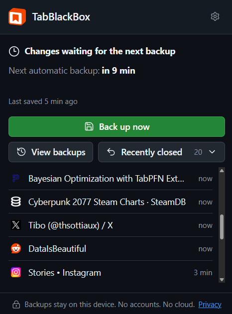
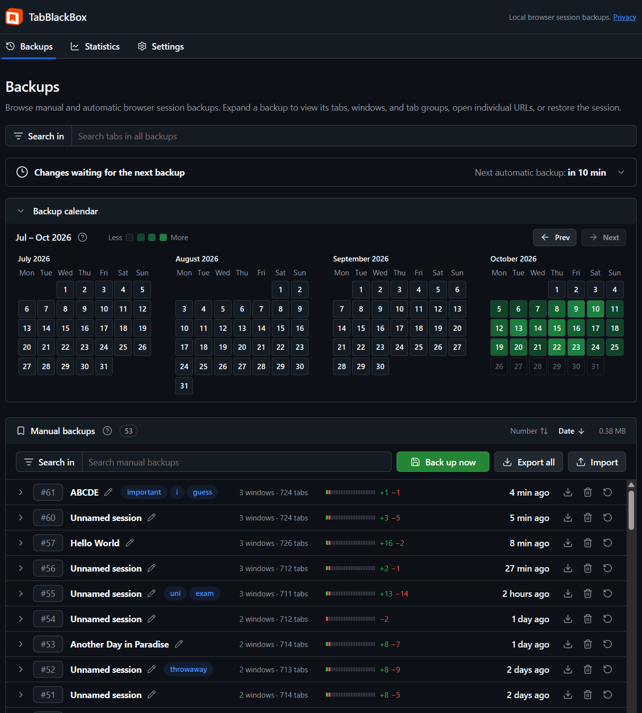
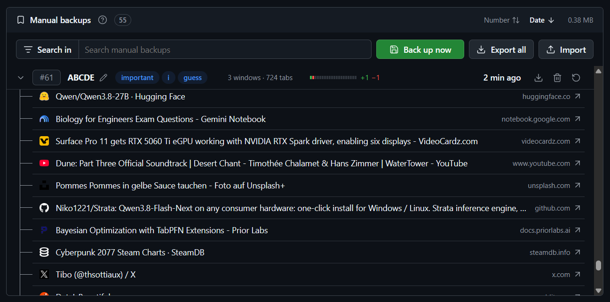
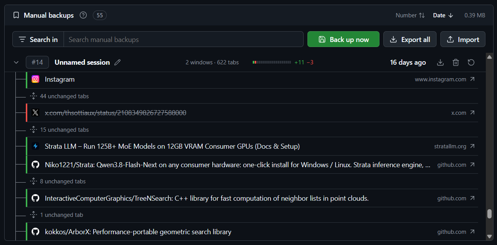
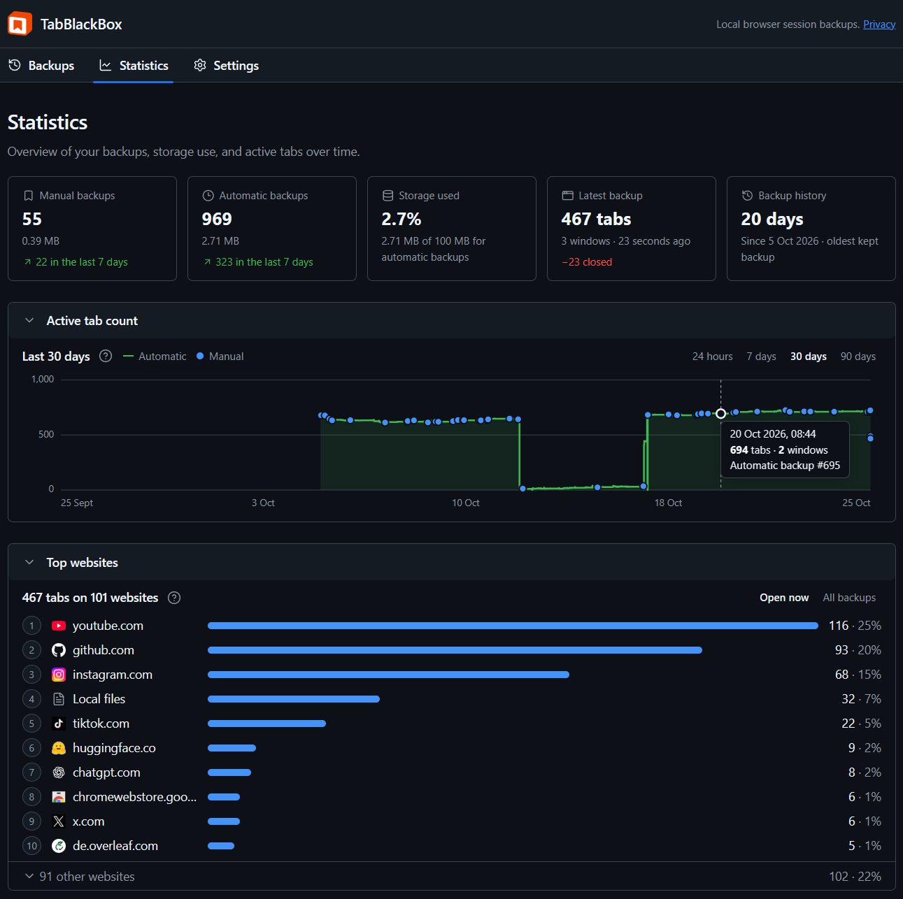
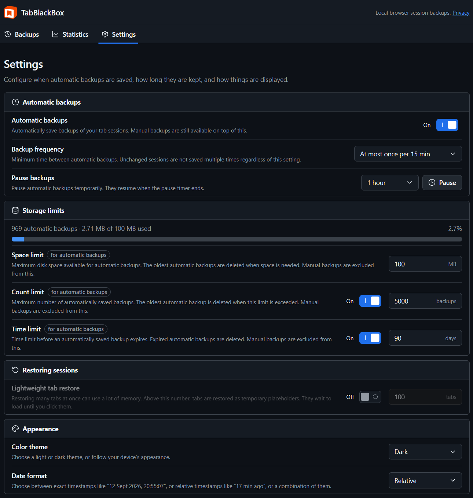

<p align="center">
  
</p>

<h1 align="center">TabBlackBox</h1>

<p align="center">
  Automatic backups, versioning, and restoration for Chromium browser tabs and sessions.<br>
  Everything stays in your browser. No accounts. No cloud.
</p>

<p align="center">
  
  
  
</p>

## Features

### Popup

The browser extension popup shows when the next automatic backup runs and when the last one was saved. Create a manual backup of your currently open tabs, list the last 20 closed tabs, or enter the backups page.



### Backups page

The Backups page marks each day on a calendar by how many backups it holds. Manual and automatic backups each have their own table, with a backup count, total storage size, and the option to sort by ID or creation date. Every entry can be expanded, renamed, tagged, exported, deleted, or the backed up tabs can be restored.



### Expanded backup

Expanding a backup shows its windows, tab groups, and every individual tab. The restore button reopens the whole session in new windows and leaves the tabs you already have open.



### Tab diff

Each backup is compared with the one before it. Added tabs have green markers, removed tabs have red markers and are crossed out, and unchanged tabs are collapsed into a single line.



### Statistics page

The Statistics page displays tab counts across automatic and manual backups, along with other info. It also tracks your active tab count over time and the websites that appear most often across your backups.



### Settings page

Set how often automatic backups run, how long they are kept, and how much space they can use. Lightweight tab restores and the color theme are also configured here.



## Install

Building it yourself requires Node.js 24 and npm:

```sh
npm install
```

```sh
npm run build
```

In a Chromium browser, open `chrome://extensions`, turn on **Developer mode**, choose **Load unpacked**, and select `.output/chrome-mv3` to add the extension.

## Testing

| Command | Purpose |
| --- | --- |
| `npm run typecheck` | Strict TypeScript checks |
| `npm test` | Unit and integration tests |
| `npm run test:install-browser` | Install an isolated Chromium for browser tests |
| `npm run test:e2e` | End-to-end tests in dedicated browser profiles |

## Privacy

Backups stay in your browser profile. TabBlackBox sends nothing anywhere, and there are no accounts or cloud. Saved URLs and titles can contain sensitive data such as access tokens or local file paths, and TabBlackBox does not encrypt its records or exports. The [bundled privacy policy](public/privacy.html) also opens offline from the popup.

## Documentation

TODO
